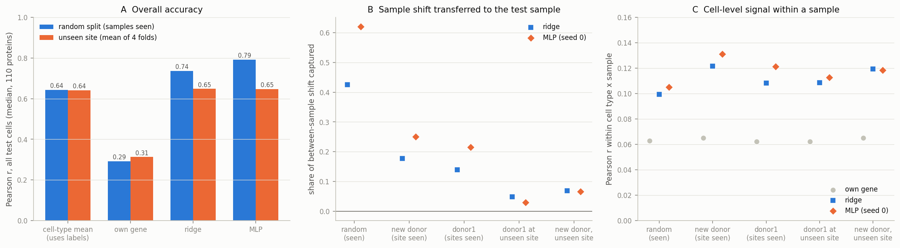
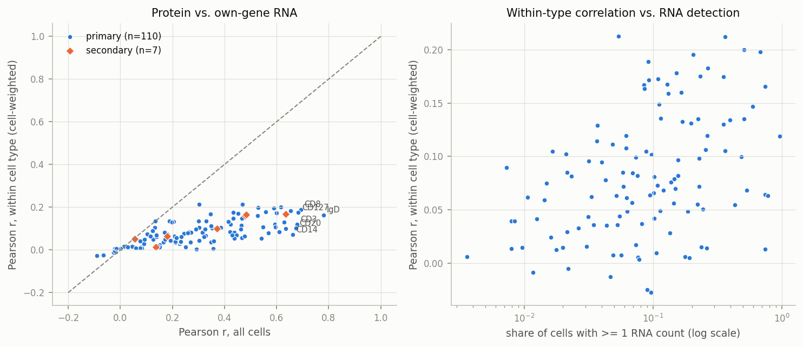
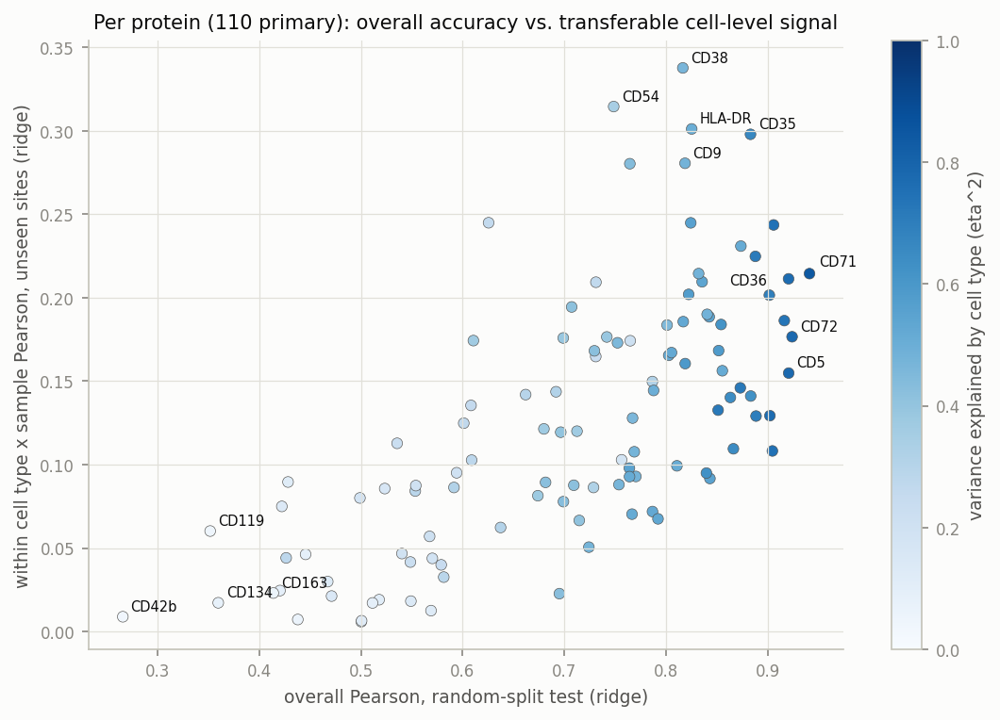

# How much of single-cell surface protein can be predicted from RNA, and from what?

A re-examination of a known problem, predicting CITE-seq surface protein (ADT) from RNA in the same
cell. It focuses on where the predictive signal comes from: cell-type identity, sample-level shifts, or
cell-to-cell variation within a sample. It does **not** propose a new method. The goal is to measure
carefully, with leakage-free splits and metrics fixed in advance.

**Main findings (110 proteins with an unambiguous gene, test sets):**
- A protein's own gene is a weak predictor within cell types. Its correlation with the protein is
  0.84 between cell-type means, but 0.07 inside a cell type.
- With a random cell split, multi-gene models clearly beat the label-based cell-type mean: ridge 0.74
  and MLP 0.79 vs 0.64 overall Pearson. They also look strong within cell types (ridge 0.34, MLP 0.44).
- Much of this within-type advantage is the prediction of **sample-level shifts for samples seen in
  training**. On the random split ridge and MLP capture 43% and 62% of these shifts. On a **site not
  seen in training** they capture 3-7%.
- On unseen sites ridge (0.65) and MLP (0.65) are no better overall than the cell-type mean (0.64), and
  ridge beats it for only 54 of 110 proteins.
- What transfers is a modest cell-level signal within a sample: Pearson about 0.11-0.12, versus 0.06
  for the protein's own gene.



## 1. Question

1. How well can surface protein be predicted from RNA in single cells?
2. How much of that comes from cell-type identity, and how much from variation *within* a cell type?
3. How do results change when the test cells come from donors or sites not seen in training?

## 2. Data

NeurIPS 2021 Open Problems CITE-seq, bone marrow mononuclear cells (GEO **GSE194122**, file
`GSE194122_openproblems_neurips2021_cite_BMMC_processed.h5ad`). Everything below was verified from the
file itself (`results/data_structure.txt`, `notebooks/00_normalization_check.ipynb`).

- **Size:** 90,261 cells; 13,953 genes + 134 surface proteins; 45 annotated cell types.
- **Donors and sites:** 9 donors, 4 sites, 12 samples (site x donor).
  - donor1 was measured at all four sites. Every other donor was measured at one site, so donor and site
    are confounded for donors 2-9.

  | donor | site1 | site2 | site3 | site4 |
  |---|---|---|---|---|
  | donor1 | 5,227 | 10,465 | 9,521 | 5,456 |
  | donor2, donor3 | 4,978 / 6,106 | | | |
  | donor4, donor5 | | 5,584 / 9,122 | | |
  | donor6, donor7 | | | 11,035 / 11,473 | |
  | donor8, donor9 | | | | 3,929 / 7,365 |

- **Normalization in the file:**
  - `layers['counts']` holds raw counts.
  - `X` is `counts / size_factor` for RNA (no log). Some size factors are implausibly small.
  - `X` is a per-cell CLR over 134 proteins + 6 isotype controls for ADT.
- **What this project uses:** RNA renormalized from counts (CP10k + log1p); protein target = the
  provided per-cell CLR.
- **Strong site effects on protein:**
  - Within donor1, median ADT counts per cell differ about 10-fold between sites.
  - The isotype (background) share varies about 5-fold by site.

## 3. Methods

- **Protein-gene map.** Built by hand (`resources/protein_gene_map.csv`) and frozen before any full-data
  correlation.
  - 110 primary proteins (direct or unambiguous mappings) carry all headline numbers.
  - 7 secondary proteins (isoforms, paralogs, mostly intracellular) are reported separately.
  - 17 proteins have no measured gene.
- **Models:**
  - global mean
  - cell-type mean (**uses the annotated labels**)
  - own gene (`y = a + b·x` per protein)
  - ridge on 2,000 HVGs (selected: full-rank PCA, equivalent to ridge on unscaled HVGs)
  - MLP (2,000 z-scored HVGs -> [1024, 512] -> 134; PyTorch, CPU)
- **Leakage rules:**
  - Everything learned from data is fit on training cells only: HVG selection, scaling, PCA, ridge
    weights, target scaling.
  - Hyperparameters were chosen on a validation part of the random split.
  - The test sets were used once, after all models were frozen.
- **Splits:**
  - **R:** random cells, 70/15/15, stratified by cell type.
  - **D:** leave-one-donor-out, 9 folds.
  - **C:** leave-one-site-out, 4 folds.

  In D and C every fold refits all learned steps with the frozen hyperparameters. The MLP stops early
  on an inner 15% of the fold's training cells.
- **Metrics (per protein, then median over proteins):**
  - Pearson over all cells.
  - Pearson within cell type (types with >= 50 cells).
  - Pearson within cell type x sample.
  - RMSE.
  - Standardized bias per (cell type x test sample): **shift captured** = 1 - Σ|b|(model) / Σ|b|(cell-type
    mean).
- **Pre-registration.** The Phase 5 design and expectations were written before any donor- or site-split
  result: commit `fa39914`, text in [`docs/analysis_log.md`](docs/analysis_log.md). One deviation is
  disclosed there: a pre-registered metric was computed after the first run, from saved predictions.

## 4. Results

### Own gene: the signal is between cell types

For the 110 primary proteins, the protein's correlation with its own gene's RNA (median) is:
- 0.29 over all cells
- **0.84** between cell-type means
- **0.07** within cell types; lower than overall for 100 of 110 proteins
- 0.06 when the sample is held fixed as well

Spearman gives the same picture.



### Models on the random split (test set)

| Model | overall r | within cell type r | within cell type x sample r |
|---|---|---|---|
| cell-type mean (labels) | 0.64 | undefined | undefined |
| own gene | 0.29 | 0.08 | 0.06 |
| ridge | 0.74 | 0.34 | 0.10 |
| MLP (mean of 3 seeds) | 0.79 | 0.44 | 0.11 |

- Holding the sample fixed removes about two thirds of the models' within-type correlation (ridge 0.34 ->
  0.10; validation analysis in `notebooks/03b`). The same holds on identical cells, and within donor1 across its four sites (0.37 -> 0.10).
- Most of the MLP's gain over ridge is in this sample-level part (validation: +0.11 within type, +0.01
  within type x sample).

### Unseen donors and sites (Phase 5, see the figure at the top)

- **Within-sample cell-level signal (panel C):** stays at 0.10-0.13 in every split, for both models.
- **Sample shift captured (panel B):**
  - random split: 0.43 (ridge) / 0.62 (MLP)
  - new donor at a seen site: 0.14-0.25
  - **unseen site: 0.03-0.07**
- **Against the pre-registered expectations:** the main test, which only the site split can contradict,
  did not contradict the hypothesis that the models' extra within-type signal comes from sample-level
  shifts of samples seen in training. Within donor1, held out at an unseen site, the bias is not smaller
  than for unseen donors. This points to site rather than donor, but the donor-split result for donor1 does
  not fit cleanly.
- **Overall accuracy on an unseen site** ranges from 0.45 (site3) to 0.81 (site1). The two weakest sites
  have the lowest ADT depth and the highest isotype share; that this explains it is a hypothesis.

### Which proteins are predicted well?



Ridge and MLP rank the proteins almost identically (Spearman 0.99 overall, 0.98 within sample).
Associations below are across the 110 proteins, looked at after the results (descriptive).

- **Overall accuracy tracks how strongly a protein separates cell types.** Spearman with the
  cell-type-explained variance η² is 0.95.
  - Best: CD71/TFRC (0.94), CD72, CD5, CD36, CD2, CD11c, CD3, CD19 (0.90 and above), all lineage markers.
  - Worst: CD42b (0.27), CD119, CD134, CD163, CD270, CD25, CD103.
- **Transferable within-sample signal is highest for** CD38 (0.34), CD54/ICAM1, HLA-DR, CD35, CD9, CD82,
  CD62L and KLRG1. It is lowest for CD137, CD83, LAG3, CD42b, CD154, CD23, CD134, CTLA4 (<= 0.02).
  Within-sample predictability goes with the protein's own-gene correlation within cell types (Spearman
  0.75).
- **Largest drop from random split to unseen site:** CD47 (0.76 -> 0.19), HLA-E, CD154, CD23, CD163,
  HLA-A-B-C, CD44. These proteins have a large between-sample variance share (e.g. CD47 0.64).
- Per-protein table: `results/phase6_per_protein.csv`.

**Biological hypotheses (not tested here)**
- **Best within-sample signal:** these proteins mark activation or differentiation states that vary
  inside an annotated type: CD38, HLA-DR and ICAM1 (activation); CD62L (naive/central memory); KLRG1
  (effector differentiation). Such states are transcriptionally programmed and leave a footprint in
  many genes, which a multi-gene model can read.
- **Worst within-sample signal:** many of these are activation-induced checkpoint or co-stimulatory
  molecules (4-1BB/CD137, OX40/CD134, CD40L/CD154, LAG3, CTLA4, CD83).
  - Their RNA is detected in <= 9% of cells, and a large share of their protein variance lies between
    samples.
  - In largely resting bone-marrow cells they may be rarely expressed, so that their ADT signal is
    dominated by sample-dependent background. CTLA4 is also mostly intracellular.
- **Largest drop to unseen sites:** broadly expressed proteins with large between-sample variance (CD47,
  CD44, HLA class I). Their random-split accuracy may rest on site-specific (technical) variation rather
  than on cell biology.

## 5. Limitations

- **Hyperparameters were frozen on the random split.** That condition rewards sample signatures, and
  the settings were chosen on validation cells from every donor. They were reused unchanged on the donor
  and site splits.
- **Donor and site are confounded** for donors 2-9. Only donor1 allows a within-donor site comparison.
  Its donor-split fold removes 34% of the training cells and the only donor linking the sites.
- **17 of 134 proteins have no measured gene.** Why these genes are missing from the file was not resolved;
  the pattern looks more like an exclusion list than a count filter (hypothesis). These proteins look
  harder: validation ridge 0.47 vs 0.73 overall. Results on 110 proteins do not generalize to 134.
- **"Within cell type" means within the 45 provided labels.** These labels were derived partly from RNA
  and protein.
- **ADT background depends on site, and CLR does not remove it.** No background correction (e.g. DSB) was
  applied. Some poorly predicted proteins may be near background (shown for CD103 and CD42b).
- **Correlation differences are a heuristic split,** e.g. 0.34 within type = about 0.23 between samples +
  0.10 within samples. They are not an exact variance decomposition.
- **Only one dataset and one tissue;** CPU-sized models; one MLP seed per D/C fold. The seed-to-seed SD
  was <= 0.003 on validation and <= 0.006 on the random test set.

## 6. Related work

Predicting surface protein from RNA has been studied with dedicated models, for example:
- cTP-net (Zhou et al., *Nature Communications*, 2020)
- sciPENN (Lakkis et al., *Nature Machine Intelligence*, 2022)
- scLinear (Hanhart et al., *Communications Biology*, 2024)

Modality prediction on this dataset was a task of the NeurIPS 2021 competition (dataset: Luecken et
al., NeurIPS Datasets and Benchmarks, 2021; results: Lance et al., PMLR, 2022). This project does not
compete with these methods. It asks which part of the predictive signal survives when donors or sites
change.

## 7. Reproduce

```bash
uv venv .venv --python 3.10
uv pip install --python .venv/bin/python --only-binary llvmlite --only-binary numba -r requirements.txt
.venv/bin/python -m ipykernel install --user --name citeseq
mkdir -p data/raw && cd data/raw
curl -L -O https://ftp.ncbi.nlm.nih.gov/geo/series/GSE194nnn/GSE194122/suppl/GSE194122_openproblems_neurips2021_cite_BMMC_processed.h5ad.gz
gunzip GSE194122_openproblems_neurips2021_cite_BMMC_processed.h5ad.gz
```

Run the notebooks in order: `00` (file check), `01` (QC, normalization, UMAP), `02`/`02b` (own-gene
correlation), `03`/`03b` (baselines), `04` (MLP), `05` (final evaluation), `06` (proteins, figures).
Unit tests: `.venv/bin/python -m pytest`.

- **Environment:** Intel Mac, 16 GB RAM. `torch==2.2.2` (CPU) with `numpy<2`; exact versions in
  `requirements-lock.txt`.
- **Peak memory:** 6 GB. **Longest notebook:** 33 min (`05`).

## Repository layout

```
notebooks/        00-06, one per phase (executed, with outputs and findings)
src/citeseq/      loading, metrics, splits, baselines, MLP, Phase 5 evaluation
tests/            unit tests, incl. leakage tests (test targets never affect predictions)
resources/        hand-made protein-gene map
results/          tables, frozen configs, saved split, figures
docs/             full phase-by-phase analysis log incl. pre-registration
```
