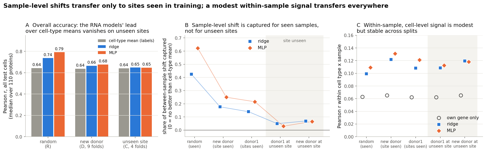
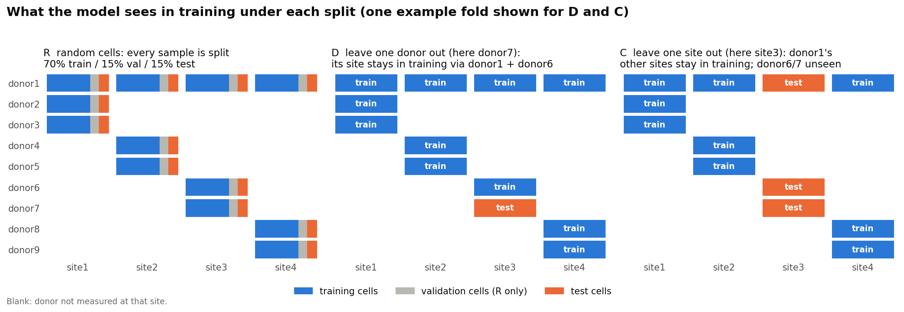

# Predicting surface protein from RNA in single cells: what transfers to new sites?

**TL;DR.** CITE-seq measures RNA and ~130 surface proteins in the same cell. This project asks how much of
a cell's protein profile its RNA can predict, and what that prediction rests on. When the test cells
come from the same samples as the training cells, ridge regression and a small neural network beat a
"cell-type average" baseline clearly (Pearson 0.74 / 0.79 vs 0.64). Most of their extra within-cell-type
accuracy comes from learning shifts that are specific to each sample, and these shifts **do not transfer
to a site that was not in training**. There the models are no better overall than the cell-type average
(0.65 vs 0.64). What does transfer is a modest cell-to-cell signal within a sample.

This is a **re-examination of a known problem, not a new method**: the aim is careful measurement with
leakage-free splits and metrics fixed in advance.



## Key findings

1. **A protein's own gene mostly tells you the cell type.** Across 110 proteins, protein and own-gene
   RNA correlate at 0.84 between cell-type averages, but only 0.07 between cells of the same type
   ([figure](results/figures/readme_own_gene.png)).
2. **Multi-gene models look strong on a random split.** Ridge and MLP reach 0.74 and 0.79 overall
   Pearson, and 0.34 and 0.44 within cell types ([table](#results-table)). Two thirds to three quarters
   of this within-type accuracy is between-sample shift: holding the sample fixed as well leaves
   0.10-0.11.
3. **These shifts transfer only to seen samples and sites.** The models capture 43% (ridge) / 62% (MLP)
   of the between-sample shift for seen samples, 14-25% for new donors at seen sites, and **3-7% at
   unseen sites** (main figure, panel B). On unseen sites the models' lead over the cell-type average
   disappears (panel A).
4. **A small within-sample signal transfers everywhere.** Within cell type and sample, the models reach
   about 0.10-0.13 in every split, about twice the protein's own gene (0.06) (panel C). Lineage markers
   are predicted best overall. Activation-state proteins (CD38, ICAM1, HLA-DR) carry the most
   transferable within-sample signal ([figure](results/figures/readme_proteins.png)).

## How to read the results

- **Pearson r over all cells.** Correlation between predicted and measured protein across all test
  cells. High values can come from cell-type differences alone. A model that only knew "this is a
  B cell" would already predict CD19 well.
- **Within cell type r.** The same correlation computed inside each annotated cell type, then averaged
  (weighted by cell count). It asks: among CD14+ monocytes, does the model rank the cells with more CD14
  above those with less?
- **Within cell type x sample r.** The same, inside each cell type of each sample (e.g. CD14+ monocytes
  of donor 6 at site 3). It removes all differences between samples, so only cell-to-cell variation
  within a sample is left.
- **Shift captured.** For each cell type in each test sample, compare the average prediction with the
  average measurement. The cell-type-average baseline cannot know that, say, site 3 reads CD47 higher
  than other sites. Shift captured = 1 − (model's total absolute bias) / (baseline's total absolute bias).
  1 means the model predicts these sample-level offsets perfectly; 0 means no better than the baseline.
- **Splits (R, D, C).** Which cells the model saw in training (figure below):
  - **R**, random cells: train and test share all samples.
  - **D**, leave one donor out: a new person, but measured at a site that is in training.
  - **C**, leave one site out: a new site, i.e. new handling and measurement conditions.



## Results table

Medians over the 110 proteins with an unambiguous gene. Test sets were evaluated once, after all models
were frozen. MLP on R: mean of 3 seeds (SD <= 0.006); on D and C: one seed per fold.

| Split (test cells) | overall r: cell-type avg. / ridge / MLP | within type x sample r: ridge / MLP | shift captured: ridge / MLP |
|---|---|---|---|
| **R** random cells (samples seen) | 0.64 / 0.74 / 0.79 | 0.10 / 0.11 | 0.43 / 0.62 |
| **D** new donor, site seen (donors 2-9, 8 folds) | 0.64 / 0.66 / 0.67 | 0.12 / 0.13 | 0.18 / 0.25 |
| **D** donor1 held out (all its sites seen) | 0.63 / 0.69 / 0.74 | 0.11 / 0.12 | 0.14 / 0.22 |
| **C** unseen site, donor1's cells (donor seen) | 0.68 / 0.68 / 0.68 | 0.11 / 0.11 | 0.05 / 0.03 |
| **C** unseen site, other donors (both unseen) | 0.64 / 0.65 / 0.65 | 0.12 / 0.12 | 0.07 / 0.07 |

- The "cell-type average" baseline uses the annotated cell-type labels, which an RNA-only model does not
  get.
- On the random split, the within-cell-type r (types pooled over samples) is 0.34 (ridge) and 0.44 (MLP).
- Overall r on an unseen site ranges from 0.45 (site 3) to 0.81 (site 1).
- On unseen sites, ridge beats the cell-type average for 54 of 110 proteins.
- Source: `results/readme_summary_table.csv`, `results/phase5_*.csv`.

The site-split expectations were written and committed before any donor- or site-split result (commit
`fa39914`; see [`docs/analysis_log.md`](docs/analysis_log.md)). Against them:
- **Main test (only the site split could contradict it): not contradicted.** The site split did not
  contradict the hypothesis that the models' extra within-type accuracy rests on sample-level shifts of
  seen samples.
- **Site vs. donor: mixed.** donor1's cells at an unseen site are not predicted better than other
  donors' cells, which points to site rather than donor. The donor-split result for donor1 does not fit
  cleanly.
- **Disclosed deviation:** one pre-registered metric was computed after the first run, from saved
  predictions, without refitting.

### Which proteins?

| | proteins |
|---|---|
| best overall (random split) | CD71, CD72, CD5, CD36, CD2, CD11c, CD3, CD19 (r >= 0.90; lineage markers) |
| worst overall | CD42b (0.27), CD119, CD134, CD163, CD270, CD25, CD103 |
| most transferable within-sample signal | CD38 (0.34), CD54/ICAM1, HLA-DR, CD35, CD9, CD82, CD62L, KLRG1 |
| least | CD137, CD83, LAG3, CD42b, CD154, CD23, CD134, CTLA4 (<= 0.02) |
| largest drop from random split to unseen site | CD47 (0.76 → 0.19), HLA-E, CD154, CD23, CD163, HLA-A-B-C, CD44 |

- Overall accuracy follows how strongly a protein differs between cell types (Spearman 0.95, across
  proteins).
- Transferable within-sample signal follows the own-gene correlation within cell types (Spearman 0.75).
- These associations were examined after the results were known.

**Hypotheses, not tested here:**
- The best within-sample proteins mark activation or differentiation states that leave a footprint in
  many genes.
- The worst are activation-induced molecules that are rarely expressed in resting bone marrow. Their RNA
  is detected in <= 9% of cells, so their ADT signal may be dominated by sample-dependent background.
- The proteins with the largest drop to unseen sites (broadly expressed, large between-sample variance)
  may owe their random-split accuracy to site-specific technical variation.

Per-protein values: `results/phase6_per_protein.csv`.

## Data and methods (short)

- **Data.** NeurIPS 2021 Open Problems CITE-seq, human bone marrow (GEO [GSE194122](https://www.ncbi.nlm.nih.gov/geo/query/acc.cgi?acc=GSE194122)).
  - 90,261 cells; 13,953 genes; 134 surface proteins; 45 annotated cell types.
  - 9 donors at 4 sites (12 samples). donor1 was measured at all four sites; every other donor at one
    site.
  - Protein depth and isotype (background) share differ strongly by site: about 10-fold and 5-fold.
- **Normalization.** RNA: counts per 10k + log1p, computed from raw counts. Protein: the provided
  per-cell CLR, whose formula was verified against the raw counts.
- **Protein → gene map.** Built by hand and frozen before results (`resources/protein_gene_map.csv`).
  - 110 proteins with an unambiguous gene carry the headline numbers.
  - 7 (isoforms, paralogs, mostly intracellular) are reported separately.
  - 17 have no measured gene.
- **Models:**
  - cell-type average
  - own gene (linear)
  - ridge on 2,000 highly variable genes
  - MLP (2,000 genes → 1024 → 512 → 134; PyTorch, CPU)
- **No leakage:**
  - Gene selection, scaling, PCA, model weights and target scaling are fit on training cells only.
  - Hyperparameters were tuned on a validation part of the random split.
  - In D and C, all of these steps are refit per fold, with hyperparameters frozen.

Full details, every intermediate result and all checks: [`docs/analysis_log.md`](docs/analysis_log.md)
and the notebooks.

## Limitations

1. **Hyperparameters were tuned on the random split.** That setting rewards learning sample shifts.
   They were not retuned for D or C.
2. **Donor and site are confounded** for 8 of 9 donors (one site each). Only donor1 allows a
   within-donor site comparison.
3. **One dataset, one tissue, 45 provided cell-type labels.** The labels were themselves derived partly
   from RNA and protein. "Within cell type" means within these labels.
4. **17 of 134 proteins have no measured gene in the file, for reasons we could not determine.** They
   look harder (validation ridge 0.47 vs 0.73), so results on 110 proteins do not generalize to all
   134.
5. **No ADT background correction (e.g. DSB) was applied.** Site-dependent background remains in the
   CLR values.
6. **Small, CPU-sized models; one MLP seed per D/C fold.** Splitting 0.34 into 0.23 between samples +
   0.10 within samples is a heuristic (a difference of correlations), not an exact variance decomposition.

More detail: [`docs/analysis_log.md`](docs/analysis_log.md) (section "Limitations (running list)").

## Reproduce

```bash
# 1. environment (Python 3.10; tested on macOS x86_64, 16 GB RAM, CPU only)
uv venv .venv --python 3.10
uv pip install --python .venv/bin/python --only-binary llvmlite --only-binary numba -r requirements.txt
.venv/bin/python -m ipykernel install --user --name citeseq

# 2. data (~616 MB download) from GEO GSE194122
mkdir -p data/raw && cd data/raw
curl -L -O https://ftp.ncbi.nlm.nih.gov/geo/series/GSE194nnn/GSE194122/suppl/GSE194122_openproblems_neurips2021_cite_BMMC_processed.h5ad.gz
gunzip GSE194122_openproblems_neurips2021_cite_BMMC_processed.h5ad.gz
cd ../..

# 3. tests
.venv/bin/python -m pytest
```

- **Environment:** exact package versions are in `requirements-lock.txt`. `torch==2.2.2` with
  `numpy<2` is required on Intel Macs. Plain `pip install -r requirements.txt` should work elsewhere,
  but only the setup above was tested.
- **Run the notebooks in order** (`notebooks/`):

  | notebook | content | runtime |
  |---|---|---|
  | `00` | file check | |
  | `01` | QC, normalization, UMAP | 3 min |
  | `02`, `02b` | own-gene correlation | |
  | `03`, `03b` | baselines and ridge (validation) | |
  | `04` | MLP (validation) | 26 min |
  | `05` | final evaluation on R/D/C | 33 min; writes per-fold predictions to `data/processed/` |
  | `06` | per-protein analysis | |

  Peak memory is about 6 GB.
- **README figures:** `.venv/bin/python scripts/make_readme_figures.py` builds them from `results/*.csv`.

## Related work and references

Predicting surface protein from RNA has dedicated methods; this project does not compete with them.

> ⚠️ **Not yet verified:** the references below were written from memory and have not been checked
> against the original publications. Remove this note after checking.

- Stoeckius et al. *Simultaneous epitope and transcriptome measurement in single cells.* Nature Methods,
  2017. (CITE-seq) ⚠️ unverified
- Luecken et al. *A sandbox for prediction and integration of DNA, RNA, and proteins in single cells.*
  NeurIPS Datasets and Benchmarks, 2021. (this dataset) ⚠️ unverified
- Lance et al. *Multimodal single cell data integration challenge: results and lessons learned.*
  Proceedings of Machine Learning Research (NeurIPS 2021 competition track), 2022. ⚠️ unverified
- Zhou et al. *Surface protein imputation from single cell transcriptomes by deep neural networks.*
  Nature Communications, 2020. (cTP-net) ⚠️ unverified
- Lakkis et al. *A multi-use deep learning method for CITE-seq and single-cell RNA-seq data integration
  with cell surface protein prediction and imputation.* Nature Machine Intelligence, 2022. (sciPENN)
  ⚠️ unverified
- Hanhart et al. *scLinear predicts protein abundance at single-cell resolution.* Communications Biology,
  2024. ⚠️ unverified (least certain)
- Mulè et al. *Normalizing and denoising protein expression data from droplet-based single cell
  profiling.* Nature Communications, 2022. (DSB) ⚠️ unverified

## Repository layout

```
notebooks/   00-06, one per phase, executed with outputs
src/citeseq/ loading, splits, metrics, baselines, MLP, final evaluation
tests/       unit tests, incl. leakage tests (changing test targets never changes predictions)
scripts/     README figures; notebook output cleaning
resources/   hand-made protein-gene map
results/     tables, frozen configurations, saved random split, figures
docs/        full phase-by-phase analysis log, incl. the pre-registration
```

## License

MIT (see `LICENSE`).
